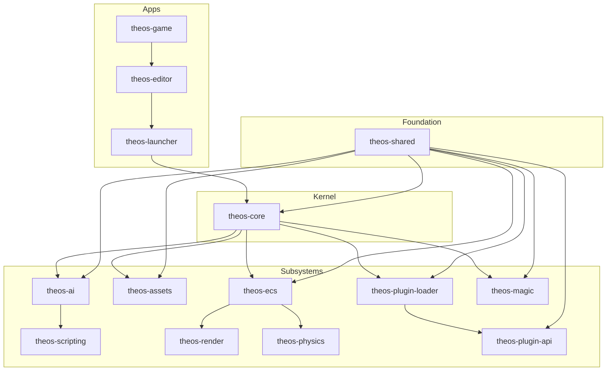

# theos-engine

[](https://codecov.io/github/FPGSchiba/theos-engine)

Tower of Theos engine workspace. This repository contains the core engine crates, launcher, editor/game binaries, and shared contracts used by first-party plugins.

## Design principles

Before splitting or merging crates, follow these rules:

1. Strict DAG: no circular dependencies. Lower-level crates do not depend on higher-level crates.
2. Compile-time isolation: each crate is an independent compilation unit, enabling parallel workspace builds.
3. One responsibility per crate: each crate should own one concern (ABI/versioning/linkage boundary).

## Crate dependency graph (overview)

Arrows mean "depends on". Lower layers are foundational.



First-party Tier-1 plugin workspace:

```text
plugins/theos-audio --> theos-plugin-api --> theos-shared + glam
```

## Workspace crates

### Foundation

- `theos-shared` (library): zero-internal-dependency shared contracts and types (`EventBus`, event taxonomy, IDs, error/result aliases, shared object-safe traits).
- **Math vocabulary:** `glam` (the library Bevy uses) is the engine's canonical, SIMD-accelerated math crate, used directly across crates with the `serde`/`bytemuck` features.
  - `theos-math` (library, **RETIRED**): an early training artifact (a thin wrapper over `glam`), kept for reference only — do not depend on it in new code. (Decision 2026-06-12, THEOS-148.)

### Kernel and subsystems

- `theos-core` (library): engine kernel, service locator, event bus implementation, thread/runtime setup, module lifecycle, and subsystem composition.
- `theos-ecs` (library): ECS layer and orchestration over `hecs`, including generational allocation and change tracking.
- `theos-assets` (library): asset loading, caching, UUID mapping, hot-reload watcher, and loader abstractions.
- `theos-render` (library, in-process): `wgpu` rendering subsystem and render graph.
- `theos-physics` (library, in-process): physics simulation integration and event publishing.
- `theos-ai` (library): async AI coprocessor and two-tier RAG pipeline.
- `theos-magic` (library, in-process): Harmonic Strings magic system — the `HarmonicToken` seam and `MagicInterface` compilation contract (M1+).

### Plugin and scripting boundaries

- `theos-plugin-api` (library): stable ABI contract for Tier-1 native plugins.
- `theos-plugin-loader` (library): plugin discovery, verification, load/unload lifecycle, and Wasm host boundary integration.
- `theos-scripting` (library): gameplay-facing Wasm/script runtime facade built on plugin loader facilities.

### Entry points and apps

- `theos-launcher` (binary): main engine entry point; wires configuration, modules, and runtime startup.
- `theos-editor` (binary): editor shell (Tauri host) and Play-in-Editor orchestration.
- `theos-game` (binary/library role): Tower of Theos game-specific systems, data, and gameplay logic.

## Plugin workspace

- `plugins/theos-audio` is a first-party Tier-1 plugin crate loaded through `theos-plugin-loader`.
- It depends on `theos-plugin-api` and shared engine contracts (`theos-shared`), using `glam` for math.

## Build and checks

Run from repository root:

```powershell
cargo build --workspace
cargo run -p theos-launcher
cargo clippy --workspace -- -D warnings
```

Enable the repository pre-commit hook once per clone:

```powershell
git config core.hooksPath .githooks
```

The hook runs `cargo fmt --all` before each commit to keep CI formatting checks green.

## Notes

- The workspace uses `resolver = "2"` and shared internal path dependencies in root `Cargo.toml`.
- `.gitignore` excludes `target` and IDE directories, and documents the policy to keep `Cargo.lock` committed.
