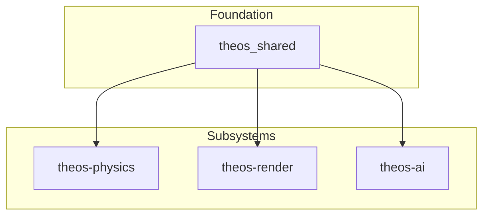

# theos-shared

Dependency-free shared contracts and types for the Tower of Theos engine.

## Purpose

`theos-shared` provides a single source-of-truth for small, engine-agnostic primitives and core event/error aliases that multiple engine subsystems consume. Centralizing these types prevents circular crate dependencies and keeps the workspace DAG clean.

## Design principles

- Zero internal dependencies (only Rust `std`).
- Minimal, stable public surface: small primitives, IDs, core event enums, and error/result aliases.
- No engine-specific logic or heavy math types — those belong in `theos-core` or `theos-math`.

## Planned public surface

- `TheosError`, `TheosResult<T>` (already present)
- `EntityId` — canonical entity identifier (see decision below)
- `Vec3` — simple (x, y, z) `f32` vector
- `Transform` — position/rotation/scale container built from `Vec3` and simple rotation primitives
- `Velocity` — linear/angular components
- `CoreEvent` — small cross-cutting event enum (Spawn/Despawn/TransformChanged, ...)
- `prelude` — convenience re-exports for common imports (added when types are present)

## EntityId (canonical decision)

- Type: `u64` wrapped in a newtype (recommended).  
- Rationale: large enough address space for game worlds and persistent storage, efficient to hash/compare, and simple to persist.  
- Behaviour & expectations: derives `Copy`, `Clone`, `Debug`, `PartialEq`, `Eq`, `Hash`, `Ord` and exposes conversions to/from `u64`.  
- Note: ID generation/allocation belongs to ECS/core runtime — `theos-shared` only defines the type.

## Serialization policy

Keep `theos-shared` dependency-free. If/when serialization is required, add an optional `serde` feature or provide a small adapter crate (for example `theos-shared-serde`) rather than making `serde` a hard dependency here.

## Usage & verification

From repository root:

```powershell
cd "D:\Projects\Tower of Theos\theos-engine"
cargo check --workspace
cargo test -p theos-shared
```

Consumer import (conceptual):

```rust
// explicit import
use theos_shared::EntityId;

// or (when we add a prelude)
use theos_shared::prelude::*;
```

## Topology (short)



## Contribution notes

- Add only types that are genuinely shared by multiple crates.  
- Keep API additive where possible to avoid breakage.  
- Document breaking changes in the crate README and the workspace changelog.

## Open decisions / TODO

- Confirm or change `EntityId` width (u64 recommended).  
- Decide whether to add a `prelude` now or later.  
- Add the concrete `Vec3`, `Transform`, `Velocity`, and `CoreEvent` types when a consuming subsystem requires them.

---
Small note: the crate currently exposes `TheosError` and `TheosResult` and defines `VERSION` in `src/lib.rs`.

